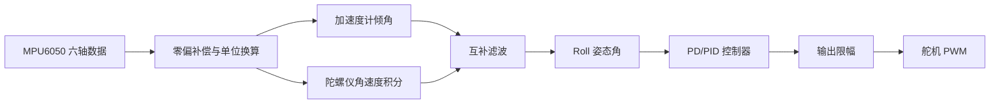

# STM32 单轴姿态闭环控制

基于 **STM32F103C8T6 + MPU6050 + 舵机** 的单轴姿态稳定与闭环控制项目。

项目以 100 Hz 读取六轴 IMU 数据，通过互补滤波估计 Roll 姿态，并使用 PD/PID 控制器驱动舵机，使被控结构向目标姿态收敛。项目重点不是手势识别，而是完成一条从传感器采集、姿态估计、闭环控制到执行器输出的嵌入式实时控制链路。

## 项目状态

当前版本为 V1，主要完成：

- STM32F103C8T6 外设初始化与 72 MHz 系统时钟配置；
- I2C1 与 MPU6050 通信；
- 加速度计和陀螺仪静态零偏标定；
- Roll/Pitch 姿态角计算；
- 互补滤波姿态估计；
- 100 Hz 定时控制回路；
- 带输出限幅的 PD 单轴姿态控制；
- 50 Hz PWM 舵机控制；
- USART1 串口调试输出。

当前控制器参数中 `Ki = 0`，所以 V1 实际运行的是 **PD 控制**，不是完整 PID 控制。

## 硬件组成

| 硬件 | 型号/说明 |
| --- | --- |
| 主控 | STM32F103C8T6 |
| 姿态传感器 | MPU6050 六轴 IMU |
| 执行器 | 舵机 |
| 调试接口 | USART1 + USB-TTL |
| 下载调试 | ST-Link / Keil MDK |
| 电源 | 3.3 V 逻辑电源及独立舵机电源 |

> 舵机建议使用独立电源，并与主控共地，避免舵机电流波动影响 MCU 和 MPU6050。

## 引脚连接

| STM32 引脚 | 外设 | 功能 |
| --- | --- | --- |
| PB6 | I2C1_SCL | MPU6050 时钟线 |
| PB7 | I2C1_SDA | MPU6050 数据线 |
| PA0 | TIM2_CH1 | 舵机 PWM |
| PA9 | USART1_TX | 串口发送 |
| PA10 | USART1_RX | 串口接收 |
| PC13 | GPIO | LED，当前未进入主控制逻辑 |

## 主要参数

| 参数 | 当前值 |
| --- | --- |
| 系统主频 | 72 MHz |
| I2C 速率 | 100 kHz |
| MPU6050 陀螺仪量程 | ±250 °/s，131 LSB/(°/s) |
| MPU6050 加速度计量程 | ±2 g，16384 LSB/g |
| 控制周期 | 10 ms，理论 100 Hz |
| 舵机 PWM | 50 Hz |
| 串口波特率 | 115200 bps |
| Kp | 2.0 |
| Ki | 0.0 |
| Kd | 0.1 |
| 控制输出限幅 | ±45° |
| 舵机角度范围 | 45°～135° |

## 控制流程



### 姿态估计

加速度计计算 Roll：

```text
AccRoll = atan2(AccY, AccZ) * 180 / π
```

互补滤波：

```text
Roll(k) = 0.98 × [Roll(k-1) + GyroX × dt] + 0.02 × AccRoll
```

该滤波器主要使用陀螺仪提供动态响应，并通过加速度计提供的重力方向抑制长期漂移。

### 控制律

当前控制误差定义为：

```text
error = target_roll - measured_roll
```

PD 输出：

```text
output = Kp × error + Kd × (error - last_error) / dt
```

舵机目标角度：

```text
servo_angle = 90° + output
```

## 软件结构

| 路径 | 功能 |
| --- | --- |
| `Core/Src/main.c` | 初始化、定时控制流程和主循环 |
| `Core/Src/tim.c` | TIM2 舵机 PWM 与 TIM3 控制定时器 |
| `Core/Src/i2c.c` | I2C1 底层初始化 |
| `Core/Src/usart.c` | USART1 串口初始化 |
| `Application/attitude.c` | Roll/Pitch 姿态估计与互补滤波 |
| `Application/pid.c` | PD/PID 控制器 |
| `Hardware/MPU6050.c` | MPU6050 配置、读取和标定 |
| `Hardware/pwm.c` | 舵机 PWM 输出 |
| `Hardware/retarget.c` | `printf` 串口重定向 |

## 编译与烧录

### Keil MDK

打开工程：

```text
MDK-ARM/AttitudeControl.uvprojx
```

执行：

```text
Project -> Rebuild all target files
```

编译成功后烧录：

```text
MDK-ARM/AttitudeControl/AttitudeControl.hex
```

### VS Code

使用 VS Code 进行代码编辑、跳转和调试，Keil 继续负责编译与烧录。

工作区配置文件位于：

```text
.vscode/c_cpp_properties.json
.vscode/settings.json
```

ARMCLANG 需要以下目标参数才能被 C/C++ 扩展正确解析：

```text
--target=arm-arm-none-eabi
-mcpu=cortex-m3
-mthumb
```

## 串口输出

USART1 配置为 115200 bps，当前调试格式类似：

```text
Roll=0.12 PID=0.24 Servo=90.24
```

其中 `PID` 字段为控制器输出。由于当前 `Ki=0`，实际控制算法为 PD。

## 已知问题

当前 V1 仍存在以下工程问题：

- MPU6050 每个字节单独读取，一个周期约 12 次 I2C 事务；
- 未检查 HAL I2C 返回值，没有 `WHO_AM_I` 校验和掉线保护；
- I2C 读取和 `atan2/sqrt` 计算位于定时器中断中，可能增加中断执行时间；
- MPU6050 内部采样率约 125 Hz，而控制周期为 100 Hz，二者未同步；
- 舵机接口使用 `uint8_t`，浮点角度存在隐式截断；
- PID 没有积分限幅和抗积分饱和机制；
- D 项直接对误差求导，对传感器噪声敏感；
- 当前只闭环控制 Roll，Pitch 仅计算未使用。

## V2 计划

V2 的目标是提升实时性、可测量性和算法可信度：

1. 使用 DWT 或 GPIO 测量控制周期与中断执行时间；
2. MPU6050 从 `0x3B` 开始连续读取 14 字节；
3. 加入设备 ID、I2C 错误和传感器掉线保护；
4. 中断只置采样标志，将高耗时处理移出中断；
5. 规范化 PD/PID 实现，加入微分滤波和抗积分饱和；
6. 实现 100 Hz 串口日志及 Python 数据绘图；
7. 实现 PD 与滑模控制的同条件对比；
8. 统计上升时间、超调、稳态误差、抗扰恢复时间和执行时间；
9. 完成重复性实验、技术报告和演示视频。

## V1 与 V2 的定位

- V1：完成一个可运行的嵌入式闭环原型；
- V2：成为一个可复现、可量化、可展示的实时控制项目。

## 免责声明

本项目仅用于嵌入式控制、姿态估计和算法验证学习。实际飞行或高速运动测试必须遵守相关法律法规，并采取隔离、限速和保护措施。
